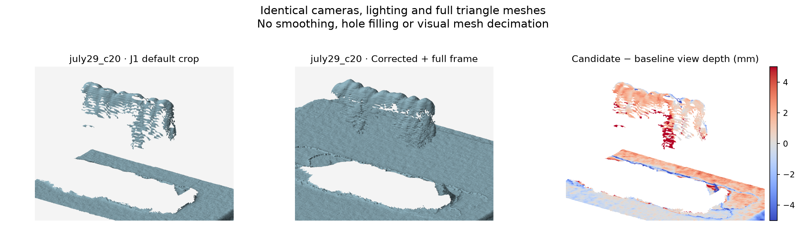
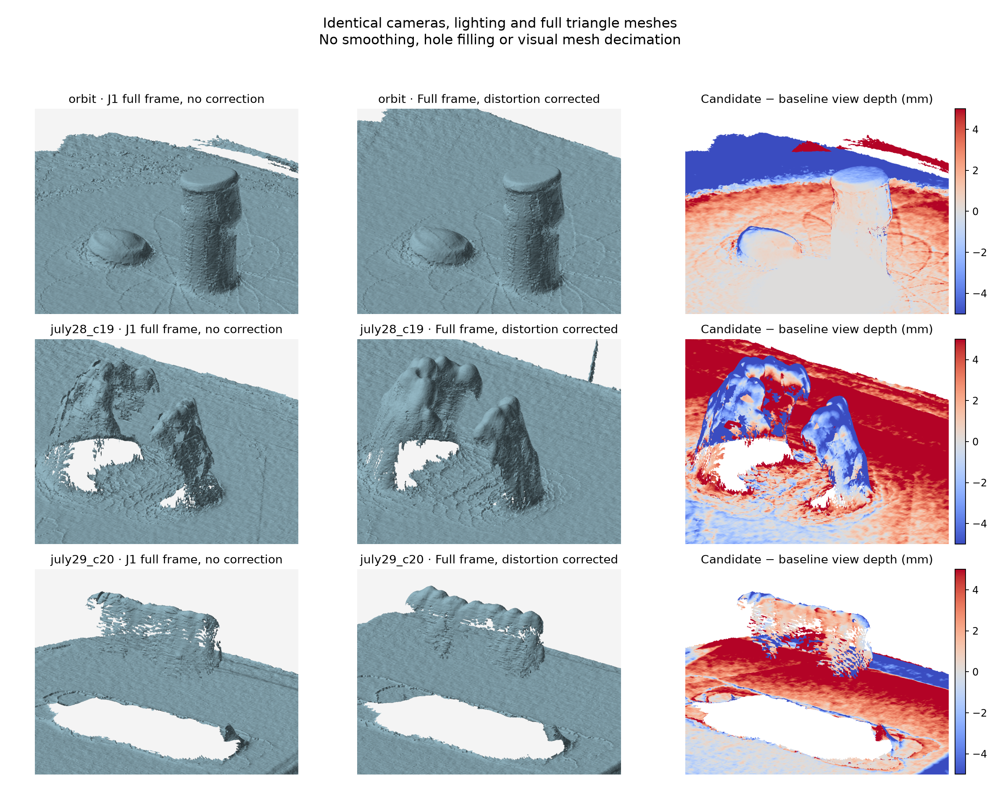

# J1 reconstruction investigation — 13 November 2026

The strongest tested offline profile is **saved-camera distortion correction,
full-frame integration, and the existing 1.953125 mm voxels / extraction weight 3**.
It improves agreement with withheld sensor observations and recovers surface lost
to the small image crop. It does not establish absolute dimensional accuracy, and
the evidence does not establish that the J1 branch caused a regression.

## Source, data, and reproducibility

`git ls-remote` verified `refs/heads/J1_Build` at
`e0d25121105883fb6958c00a690329e839132c7b` on 13 November 2026. The investigation
branch is `codex/j1-reconstruction-quality`, based on that exact commit, in a
separate managed worktree. The original clean checkout remains on
`feature/offline-robot-agent` at `cb89bce64b4c548073e8b1024a7ca77849e57335`.

All reconstruction Python sources are identical between J1 and the common
ancestor `59d8427`. The last cropped-TSDF change is `ca712ac3ce51ef396183c976119e2d73a7e1fde7`
(27 July 2026), which added optional adaptive cropping and mesh component cleanup.
Its parent `41dc7433b6bdc2cf15038a8f8f175655dfef28ef` is an earlier comparison point.
The saved outputs do not include a trustworthy producer commit and complete
runtime settings; their acquisition/reconstruction provenance must not be inferred
from folder names alone.

Five local sessions under `/Users/josephnamar/Downloads` contain 62 manifests,
667 depth frames and 62 saved STL meshes:

| Session | Scans | Frames | Views per scan |
|---|---:|---:|---:|
| `260625_110936` | 10 | 100 | 10 |
| `260717_151744` | 1 | 20 | 20 |
| `260727_163002` | 1 | 17 | 17 |
| `260728_133013` | 23 | 368 | 16 |
| `260729_165741` | 27 | 162 | 6 |

Every depth image is 640×576. No exact duplicate depth files were found within a
scan. The July 28 cycle 1 scan lacks all 16 raw color files, so it was excluded
from complete pipeline replay. Existing aligned color there is not a substitute
for a fresh RGB alignment baseline. Calibration and pose records are present.
No independent measured object geometry or matching depth-bias calibration
capture was found in these five sessions.

Seven complete scans were selected across all sessions: June cycle 1, July 17
cycle 0, July 27 orbit scan, July 28 cycles 6 and 19, and July 29 cycles 0 and 20.
This covers early/late geometry and 6/10/16/17/20-view capture patterns. It is a
representative regression set, not a replay of all 62 scans. The user confirmed
these saved examples are suitable and will supply new scans later.

Each run copies its inputs into a new session directory, snapshots reconstruction
source, hashes original input files, records explicit settings and package
versions, logs processing, and refuses to overwrite an experiment directory.
Original files are never linked to writable experiment files. The default J1
baseline was established before candidate processing. Separate 350×350 and
full-frame baselines isolate crop effects from distortion effects.
The final integrity check verified **2,129 original files unchanged**, including
raw captures, manifests, calibration, and saved meshes (`final_integrity.json`).

Large artifacts are retained outside Git at:

```
/Users/josephnamar/.codex/visualizations/2026/11/13/01a1d591-ef53-71a1-b5d1-4895a2ba80d2/reconstruction_quality
```

`saved_inventory.json` contains raw-input and saved-mesh hashes and topology.
Each run contains `run.json`, pinned `source/`, copied `session/`, reconstructed
STL/PLY, and evaluation JSON. The `final_candidate_v2/<case>/session/scan/reconstruct`
directories contain the recommended candidate outputs. `baseline_v1`,
`crop350_v1`, and `baseline_full` preserve the three baselines.
An initial runner invocation failed before reconstruction because of a keyword
typo; its incomplete `baseline/` folder is retained and excluded from all results.

## Actual workflow

1. **Capture and calibration.** `print_move.launch.py` launches the Orbbec Femto
   driver, capture node, reconstruction services and world/field nodes. The
   repository targets Ubuntu 24.04 / ROS 2 Jazzy and pins Orbbec ROS2 to v2.4.5.
   `sense_node.py` and `femto_capture.py` save raw RGB/depth/IR and
   `manifest.yaml`. RGB/depth use approximate synchronization (50 ms slop), with
   latest-raw fallback. Robot pose uses the latest TF transform, not a lookup at
   the depth timestamp; the saved manifest cannot establish image/pose latency.
   `config/*_intrinsics.yaml` stores K, D and dimensions; `extrinsics.yaml`
   snapshots the calibrated optical-frame transforms from TF. Hand–eye scripts
   use ChArUco observations, OpenCV hand–eye methods and optional robust refinement;
   reconstruction consumes the saved transforms rather than recalibrating.
2. **Pose chain.** `utils/manifest.py` loads `T_base_tool0`; each depth camera pose
   is `T_base_ir = T_base_tool0 @ T_tool0_ir`. TSDF receives its inverse. Geometry
   is in meters in `ur20_base_link`. No ICP, pose graph optimization, or SLAM
   registration is applied in the active path.
3. **Color alignment.** `color_to_depth.py` maps depth pixels through
   `inv(T_tool0_color) @ T_tool0_ir`, then samples RGB. The baseline loads D but
   uses ideal pinhole projection for both cameras. Raw depth is interpreted as
   millimeters, with a 1 m alignment cutoff. Images normally go to
   `<scan>/reconstruct/color_in_depth/`.
4. **Preprocessing and fusion.** `TSDF_cpu_cropped.py` loads depth in manifest
   order, applies the configured pixel crop and an additive depth correction.
   `DEPTH_BIAS_MM=-5.1` becomes **−5 mm** on integer depth. Defaults are 270×290
   central pixels, 0.9 m maximum range, 1/512 m voxels, 12-voxel blocks, and
   10,000 initial blocks. Open3D 0.19's default truncation multiplier is 8
   (15.625 mm here), and its extraction weight threshold is 3
   ([API reference](https://www.open3d.org/docs/release/python_api/open3d.t.geometry.VoxelBlockGrid.html)).
5. **Extraction and postprocessing.** Open3D extracts the TSDF triangle surface.
   A separate point-cloud path retains at least three projected color-valid
   observations within a 20 mm depth band, optionally crops/slices it, fits a
   table plane, and applies statistical outlier removal (35 neighbors, 1.5 std).
   The mesh receives AABB/adaptive cropping if enabled and removal of components
   smaller than 50 triangles. It does **not** inherit the point cloud's full
   confidence/outlier/table-slice filtering. There is no smoothing in this path.
6. **Outputs and consumers.** The main products are `tsdf_surface_mesh.stl`, an
   indexed `tsdf_surface_mesh.ply`, `tsdf_surface_rgb_colored.ply`, and
   `table_plane.json`. A confidence-colored point cloud is constructed, but the
   current cropped script does not actually write the advertised confidence PLY.
   `scan_session.py` runs alignment then TSDF and publishes the resulting mesh.
   `world_node.py` provides visualization/world geometry; planning-scene mesh
   updates must use the same base frame. Scalar-field and print-candidate tools
   consume this geometry but do not validate sensor accuracy.

`TSDF_cpu_object_extract.py` is a separate older point-cloud extraction route
using a saved table plane, different range/crop settings, and no equivalent depth
bias correction. It is not interchangeable with the cropped mesh path. Standalone
scripts under `python_scripts/3d_reconstruction` are also separate copies; the ROS
entry points in `behav3d_sense/setup.py` call the package implementation tested here.
The cinematic renderers and printing simulators are visualization/planning tools,
not evidence of reconstruction accuracy.

Configuration is consequential: field workflows use 350×350 depth crops;
`scan_yaml_targets_sequence_config.yaml` disables the image crop; the print-YAML
workflow crops color but leaves depth uncropped. ROS service parameters persist
between requests. The orchestration alignment wait currently accepts a single
fresh image, while the service runs asynchronously; offline replay bypasses this
potential partial-output race by running both stages synchronously to completion.
It is an identified live-workflow risk, not a demonstrated cause in these saved
results.

## Initial findings and comparison protocol

Earlier June saved meshes have 74–807 connected components, versus 1–8 in the
July 28/29 saves. Component cleanup can explain part of this difference; it is
not proof of improved accuracy. Fixed views show substantial crop differences
between saved outputs and a module-default replay. Thus neither visual smoothness
nor different mesh counts establishes a chronological regression.

The calibration contains substantial nonzero rational distortion. On the July 28
calibration, mapping the pinhole grid to raw depth pixels moves pixels by up to
17.6 px inside the default crop, 28.8 px in 350×350, and 98.4 px over the full
frame. [Orbbec documents original Femto Mega depth/color as distorted](https://github.com/orbbec/OrbbecSDK_v2/blob/main/docs/tutorial/orbbec_camera_distortion.md). The launch
configuration disables depth-to-color registration. These facts motivate testing
rectification; the saved sessions still lack a complete driver/filter provenance
record, so the assumed raw-image convention must be verified for future scans.

The protocol fixes original inputs, poses, calibration, frame order, bias, voxel
resolution, TSDF truncation, extraction weight, cleanup, and random seed. Camera
correction and crop are first tested independently in a 2×2 comparison. Additional
full-frame, lower extraction-weight, finer voxel, and shorter truncation experiments
test the completeness/detail/noise tradeoff. No alignment is optimized against the
evaluation frames.

Depth agreement raycasts the actual triangle mesh from saved camera poses. Ray
directions have camera Z=1, so hit distance is axial depth. Both ideal-pinhole and
saved-distortion interpretations are recorded, exposing dependence on the optical
model. Primary metrics use the saved distortion model. A fixed common central ROI
and a second full-frame ROI are evaluated with identical ray denominators across
variants. Missing mesh hits count against coverage and the within-5-mm fraction.
Depth-edge pixels are reported separately from interiors. Object-region proxies
are raw observations 15–500 mm above the saved table plane; they are **not semantic
ground truth**. This avoids letting table pixels dominate the object results.

Held-out checks omit every fourth manifest position starting at 3, reconstruct
from the remaining views, and evaluate only omitted depth frames. The split is
fixed before subset replay. This is exploratory cross-validation: all-view
summaries were already inspected, and the scans share session calibration. It is
not an untouched external test set. The orbit example remains the hardest case.

Mesh topology, area, boundary length, table-plane residuals, fixed orthographic
views, geometric displacement maps, and runtime complement depth agreement.
Table residuals include possible real table warp and low objects. Geometric
change and surface count are not accuracy measures by themselves.

## Results and decision

The machine-readable results and all numerical comparisons are in
[`RESULTS.md`](RESULTS.md) and [`summary.json`](summary.json). Representative
matched full-frame comparisons are shown below. Lighting and cameras are identical;
no smoothing, hole filling, or display decimation is applied.

The combined correction and crop change recovers much of the sparse scan's wall:



The following comparison holds full-frame integration fixed to isolate distortion:



Distortion correction improves object depth residuals in all seven full-frame
cases and all seven held-out checks. Wider integration recovers many surfaces
removed by the early pixel crop, especially on six-view scans. It preserves the
existing extraction threshold, rather than relying on single-view filled geometry.
The best tested profile is therefore rectification plus full-frame integration
with the original 1.95 mm voxel, 15.625 mm truncation and weight 3. It is the best
of the tested settings, not a claim of globally optimal reconstruction.

The 1 mm voxel experiment produced about four times as many triangles and more
components, with no depth-agreement gain on the three detail cases. Shortening
truncation to 7.8125 mm reduced some residuals but removed coverage and increased
fragmentation. Weight 2 improved cropped coverage but can admit less-supported
surface; full-frame weight 3 was preferred. These settings were not promoted to
production defaults. No ICP or unconstrained recalibration was added.

## Reviewable code change

The package now offers `rectify_images=True` / `--rectify-images` for the two
offline stages. It uses the saved K/D to rectify onto the same image dimensions
and K before cropping and projection. Depth uses nearest-neighbor sampling to
avoid creating depths across discontinuities; RGB uses linear interpolation.
Raw files are never modified. Rectified alignment is stored separately in
`color_in_depth_rectified/`, with a completion marker and manifest/calibration
hashes. TSDF rejects incomplete, stale or incompatible rectified alignment.
`--no-center-crop` exposes full-frame integration for offline CLI use.

Existing default behavior and ROS service requests remain unchanged. The new
profile is opt-in and currently exposed by the offline Python API/CLI, not by a
new ROS service parameter. This avoids silently applying distortion correction
to future streams that may already be rectified. The separate object-extraction
route remains on its legacy aligned-image folder.

Seven 350×350 legacy replays reproduce original geometry exactly, and seven production
rectification replays reproduce the independently staged rectification experiment
exactly (zero vertex difference, identical triangle connectivity after remapping
indices). Nine focused numerical and capture tests pass. A full ROS/ament test run is
not available on this macOS host; ament lint packages and the robot runtime are
absent. No hardware, robot services, or external publication was used.

## Limits and next comparison

There is no independent ground truth. The fixed −5 mm bias, calibration accuracy,
pose latency, multipath effects and actual fine-scale surface detail remain
unverified. Full-frame integration can include table/background geometry; a
post-fusion world-space crop may be useful after reviewing object extents. Some
thin/occluded surfaces remain missing, especially on sparse views. Color accuracy
has not been independently measured. The opt-in profile is suitable for review,
not yet a justification for an automatic live-system default change.

For the next supplied scans, freeze this candidate before evaluating them. Keep
the complete session `config`, manifests, raw depth/color and earlier reconstruction
outputs, plus the actual camera driver settings and reconstruction parameters.
Replay both J1 and this candidate with identical crops and views, then compare
the object-region and held-out metrics already implemented. A known dimension or
independently measured plane/object would let us test absolute bias and scale.
Review those results before changing live defaults or merging.
