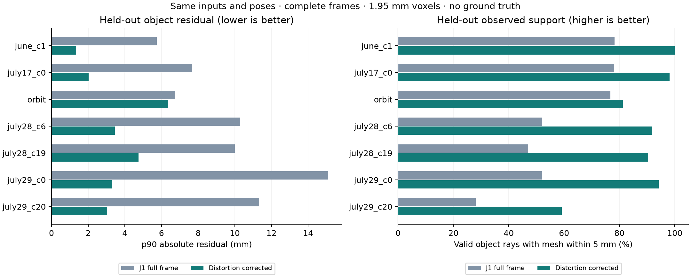

# Reconstruction comparison results

Baseline: `e0d25121105883fb6958c00a690329e839132c7b`. Same saved inputs, calibration and poses in each paired comparison.

## Matched full-frame optical-model comparison

Both columns use full-frame depth, 1.953125 mm voxels, 15.625 mm truncation and weight 3. Only distortion correction changes. Object regions are fixed raw-depth proxies 15–500 mm above the saved table plane. These are sensor-consistency measures, not ground-truth errors.

| Case | Object p90 absolute residual, J1 → corrected (mm) | Object rays within 5 mm, J1 → corrected | Interior hit coverage, J1 → corrected |
|---|---:|---:|---:|
| june_c1 | 4.60 → 1.35 | 92.7% → 100.0% | 99.0% → 100.0% |
| july17_c0 | 9.08 → 2.06 | 70.4% → 98.0% | 99.1% → 99.9% |
| orbit | 6.17 → 5.44 | 82.8% → 87.2% | 100.0% → 100.0% |
| july28_c6 | 10.29 → 3.38 | 51.8% → 95.8% | 97.1% → 99.9% |
| july28_c19 | 11.48 → 4.27 | 46.8% → 93.7% | 97.4% → 99.9% |
| july29_c0 | 9.42 → 4.71 | 59.7% → 75.8% | 90.3% → 92.6% |
| july29_c20 | 12.34 → 4.89 | 40.7% → 72.1% | 91.1% → 92.7% |

## Withheld-view comparison

Every fourth view (positions 3, 7, …) is omitted from fusion and used only for evaluation. The table reports object-region rays in the fixed central ROI. This is exploratory validation on already inspected sessions, not a blinded external test.

| Case | Held-out object p90, J1 → corrected (mm) | Held-out object rays within 5 mm, J1 → corrected |
|---|---:|---:|
| june_c1 | 5.75 → 1.34 | 78.3% → 100.0% |
| july17_c0 | 7.66 → 2.03 | 78.1% → 98.1% |
| orbit | 6.73 → 6.37 | 76.7% → 81.2% |
| july28_c6 | 10.30 → 3.45 | 52.1% → 91.8% |
| july28_c19 | 10.01 → 4.75 | 47.0% → 90.3% |
| july29_c0 | 15.10 → 3.30 | 51.9% → 94.2% |
| july29_c20 | 11.33 → 3.03 | 28.1% → 59.1% |

## Coverage versus the original default crop

This comparison combines two changes: distortion correction and removal of the early image crop. The matched tables above isolate the correction. Hit coverage is measured on the same raw rays; missing hits count against it.

| Case | J1 default 270×290 interior hits | Corrected full-frame interior hits |
|---|---:|---:|
| june_c1 | 47.9% | 100.0% |
| july17_c0 | 81.2% | 99.9% |
| orbit | 96.8% | 100.0% |
| july28_c6 | 66.8% | 99.9% |
| july28_c19 | 75.0% | 99.9% |
| july29_c0 | 25.8% | 92.6% |
| july29_c20 | 29.9% | 92.7% |

## Other controlled settings

The rows below retain rectification and the 350×350 crop. Smaller voxel tests keep the physical truncation distance constant. Lower residuals on surviving hits must be weighed against deleted coverage and fragmentation.

| Case | Setting | Interior p90 (mm) | Interior hit coverage | Components | Triangles |
|---|---|---:|---:|---:|---:|
| orbit | reference | 4.19 | 99.9% | 1 | 261,072 |
| orbit | weight 2 | 4.19 | 100.0% | 2 | 287,798 |
| orbit | 1 mm voxels | 4.21 | 100.0% | 13 | 1,116,437 |
| orbit | 7.8125 mm truncation | 3.90 | 99.8% | 1 | 252,497 |
| july28_c19 | reference | 2.16 | 89.8% | 2 | 395,021 |
| july28_c19 | weight 2 | 2.14 | 95.7% | 1 | 476,579 |
| july28_c19 | 1 mm voxels | 2.17 | 89.6% | 14 | 1,662,980 |
| july28_c19 | 7.8125 mm truncation | 2.07 | 89.4% | 13 | 364,399 |
| july29_c20 | reference | 1.92 | 45.9% | 6 | 112,260 |
| july29_c20 | weight 2 | 1.84 | 71.9% | 10 | 231,752 |
| july29_c20 | 1 mm voxels | 2.08 | 46.9% | 13 | 472,254 |
| july29_c20 | 7.8125 mm truncation | 1.64 | 43.7% | 7 | 99,096 |

## Runtime

Median of three sequential paired runs, alternating order, CPU with 4 OpenMP / 1 OpenBLAS / 1 OpenCV threads. Both profiles use full-frame images. Timing includes alignment, rectification where enabled, TSDF, filtering and output writes; excludes interpreter import, input copying, hashing and evaluation. Other host activity is uncontrolled.

| Case | J1 pipeline (s) | Corrected pipeline (s) | Added time (s) |
|---|---:|---:|---:|
| orbit | 2.723 | 3.061 | 0.338 |
| july29_c20 | 1.444 | 1.730 | 0.286 |

## Validation and remaining uncertainty

- All seven legacy 350×350 replays match their baseline geometry exactly.
- All seven final production candidates match the independent full-frame rectification experiment exactly: identical vertices and triangle connectivity after index remapping.
- Nine focused capture/rectification tests pass. Full ROS/ament lint and live integration were not available on macOS.
- Fine detail, absolute dimensions, hand–eye accuracy, depth bias, pose latency and color accuracy are not independently verified. Residuals can share calibration/systematic errors with the inputs.
- The orbit held-out object p90 remains above 6 mm. Sparse-view surfaces retain occlusions and holes; no hole filling or smoothing is used to conceal them.
- Both pinhole and saved-distortion ray models, full-frame evaluation, mesh topology and plane-fit metrics remain in `summary.json` and the detailed run records.

No merge or live-system default change has been made. See [the workflow and investigation](INVESTIGATION.md) and [reproduction instructions](../../tools/reconstruction_quality/README.md).
